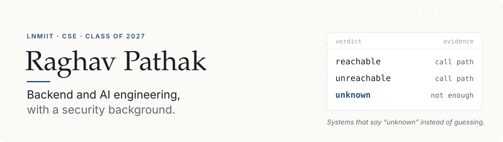
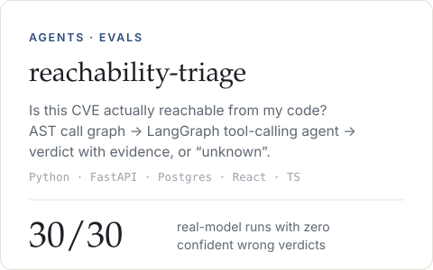
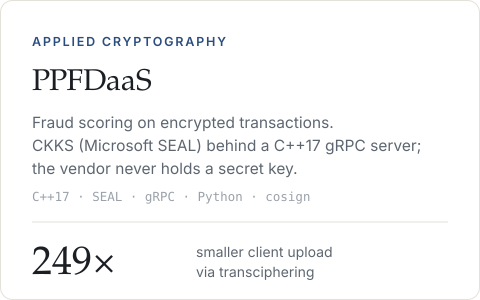
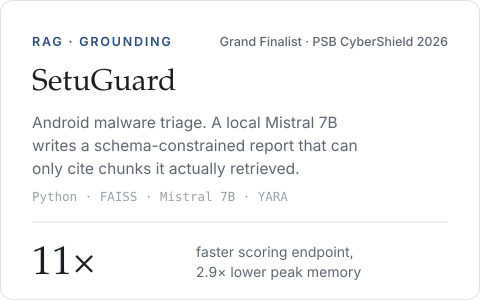
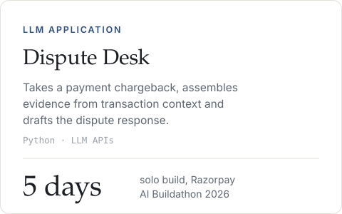
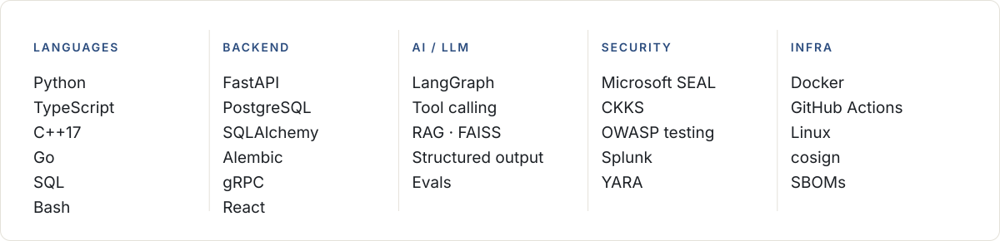

<picture>
  <source media="(prefers-color-scheme: dark)" srcset="assets/header-dark.svg">
  
</picture>

  <a href="https://raghavpathak.me"><b>raghavpathak.me</b></a> &nbsp;&nbsp;·&nbsp;&nbsp;
  <a href="https://linkedin.com/in/raghav-pathak-b14b46282">LinkedIn</a> &nbsp;&nbsp;·&nbsp;&nbsp;
  <a href="mailto:raghavpathak0130@gmail.com">Email</a>

I build systems that are honest about what they don't know: an agent that answers *unknown* instead of guessing whether a CVE is reachable, a RAG pipeline that can only cite what it actually retrieved, and encrypted inference where the server never sees the data it scores.

&nbsp;

## Now

**Software Engineering Intern (AI & Automation), MarkeTreasure** &nbsp;·&nbsp; *Sep 2026 – present* 
Auditing a rule-based equity screener (~12,000 stocks, ~30 years of daily OHLCV). 70+ defects catalogued; an independent review verified 61 of 68 audit claims and found none wrong.

**Undergraduate researcher, LNMIIT** &nbsp;·&nbsp; *2025 – present* 
CKKS homomorphic-encryption inference vs. HERA and Rubato transciphering for fraud scoring on encrypted data, with Prof. Debranjan Pal. Paper in preparation.

&nbsp;

## Selected work

  <a href="https://github.com/raghavpathak30/reachability-triage">
    <picture>
      <source media="(prefers-color-scheme: dark)" srcset="assets/card-reachability-dark.svg">
      
    </picture>
  </a>
  <a href="https://github.com/raghavpathak30/PPFDaaS">
    <picture>
      <source media="(prefers-color-scheme: dark)" srcset="assets/card-ppfdaas-dark.svg">
      
    </picture>
  </a>

  <a href="https://github.com/raghavpathak30/SetuGuard">
    <picture>
      <source media="(prefers-color-scheme: dark)" srcset="assets/card-setuguard-dark.svg">
      
    </picture>
  </a>
  <a href="https://github.com/raghavpathak30/razorpay-disputedesk">
    <picture>
      <source media="(prefers-color-scheme: dark)" srcset="assets/card-disputedesk-dark.svg">
      
    </picture>
  </a>

Also: <b>PwnBot</b>, an LLM pentest assistant over the Groq API with structured tool-output parsing and a scope guard that refuses targets outside the declared engagement.

&nbsp;

## How I report numbers

> Every headline number in these repositories traces to a committed artifact file. When a measurement turned out to be invalid (wrong parameter set, contaminated corpus, unreproducible host), the correction sits next to the original instead of replacing it. [`MEASUREMENT_PROVENANCE.md`](https://github.com/raghavpathak30/PPFDaaS) in PPFDaaS is the clearest example.

&nbsp;

## Stack

<picture>
  <source media="(prefers-color-scheme: dark)" srcset="assets/stack-dark.svg">
  
</picture>

&nbsp;

## Experience

**MarkeTreasure Investment LLC** &nbsp;·&nbsp; Software Engineering Intern (AI & Automation) &nbsp;·&nbsp; *Sep 2026 – present, remote*

**Omni Infoword** &nbsp;·&nbsp; Cybersecurity Intern &nbsp;·&nbsp; *May – Jul 2026 (7 weeks)* 
SOC alert triage across Splunk, Microsoft Sentinel, QRadar and Elastic, then an OWASP Top 10 test pass on pre-release software.

**LNMIIT** &nbsp;·&nbsp; Undergraduate Researcher &nbsp;·&nbsp; *2025 – present*

Hack The Box Academy, Skilled rank &nbsp;·&nbsp; Google Cybersecurity Professional Certificate &nbsp;·&nbsp; Head of Sponsorship, Vivacity
